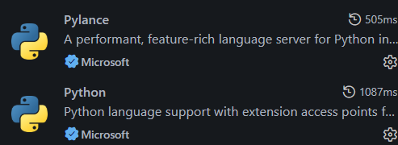
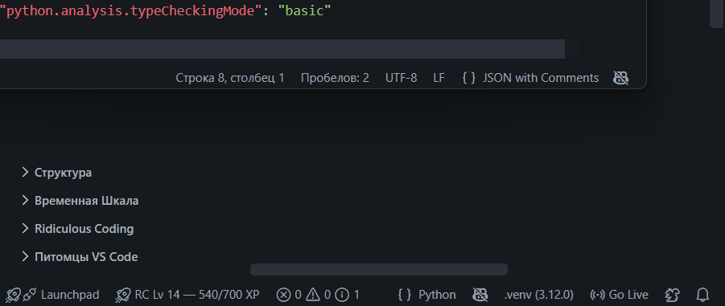
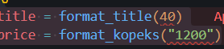
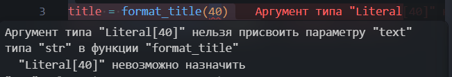
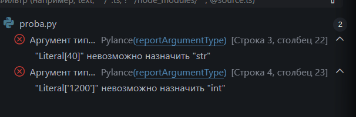
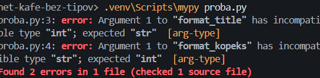
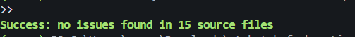

# Отчёт · Проверка типов: Pylance и mypy

**Студент:** Dxlol

## 1. Подготовка





## 2. Проверка в редакторе

```python
from app.utils.formatter import format_kopeks, format_title

title = format_title(40)
price = format_kopeks("1200")
```





Разбор сообщения:

| Часть сообщения | Что означает |
|---|---|
| `Literal[40]` | Передано конкретное целое число `40`. |
| Параметр `text` функции `format_title` | Ошибка относится к первому аргументу вызова. |
| Тип `str` | Параметр принимает строку, поэтому аргумент нужно передать в кавычках. |



## 3. Проверка в терминале

```text
het-kafe-bez-tipov> .venv\Scripts\mypy proba.py
proba.py:3: error: Argument 1 to "format_title" has incompatible type "int"; expected "str"  [arg-type]
proba.py:4: error: Argument 1 to "format_kopeks" has incompatible type "str"; expected "int"  [arg-type]
Found 2 errors in 1 file (checked 1 source file)
```



```text
het-kafe-bez-tipov> .venv\Scripts\mypy proba.py
Success: no issues found in 1 source file
```

## 4. Проект без аннотаций

| Этап | Итог `mypy app` |
|---|---|
| исходно | 15 ошибок в 9 файлах |
| после `utils` | 12 ошибок в 7 файлах (проверочная копия) |
| после `domain` | 8 ошибок в 5 файлах |
| после `services` | 1 ошибка в 1 файле |
| после `ui` | Ошибок нет |

Модуль до и после — `app/services/orders.py`:

```python
def load_orders(path):
def revenue_by_waiter(orders, top=0):
def sort_orders_in_place(orders):
```

```python
def load_orders(path: Path) -> list[Order]:
def revenue_by_waiter(orders: list[Order], top: int = 0) -> dict[str, int]:
def sort_orders_in_place(orders: list[Order]) -> None:
```

```tex
> python -m mypy app
Success: no issues found in 15 source files
> python -m pytest -q
............                                                             [100%]
12 passed in 0.11s
> python -X utf8 main.py
=========== Смена 06.11.2026 ===========
Петрова Анна                  2 480,50 ₽
Иванов Пётр                   1 685,00 ₽
Сидоров Илья                    772,00 ₽
=========== Итого 4 937,50 ₽ ===========
```



## 5. Выводы

Pylance подсвечивает несовместимые аргументы в редакторе, а mypy показывает их в терминале с номерами строк и кодами ошибок. Аннотация `-> None` нужна и для функций, которые только меняют состояние или печатают текст. Проверка типов пропустит ошибку, если у функции не задан тип возвращаемого значения, если стоит basic.
