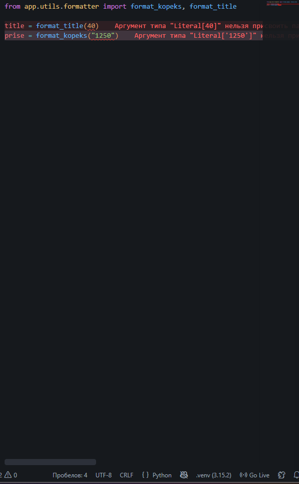
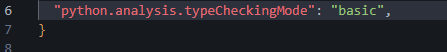
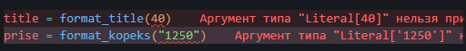
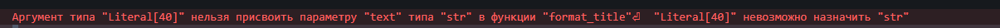
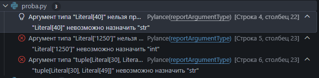
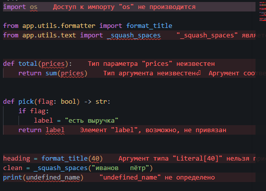
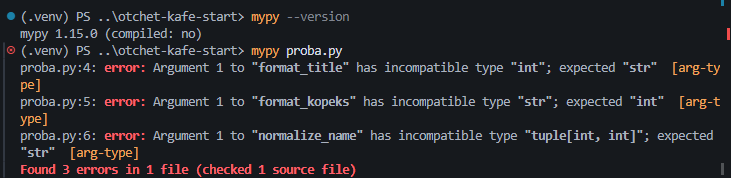
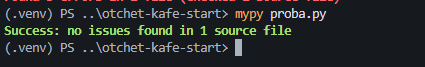
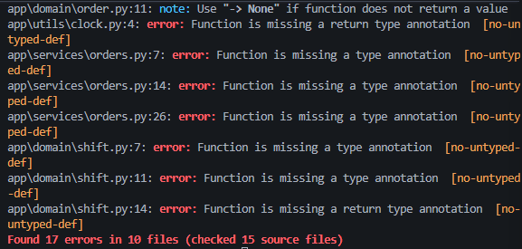
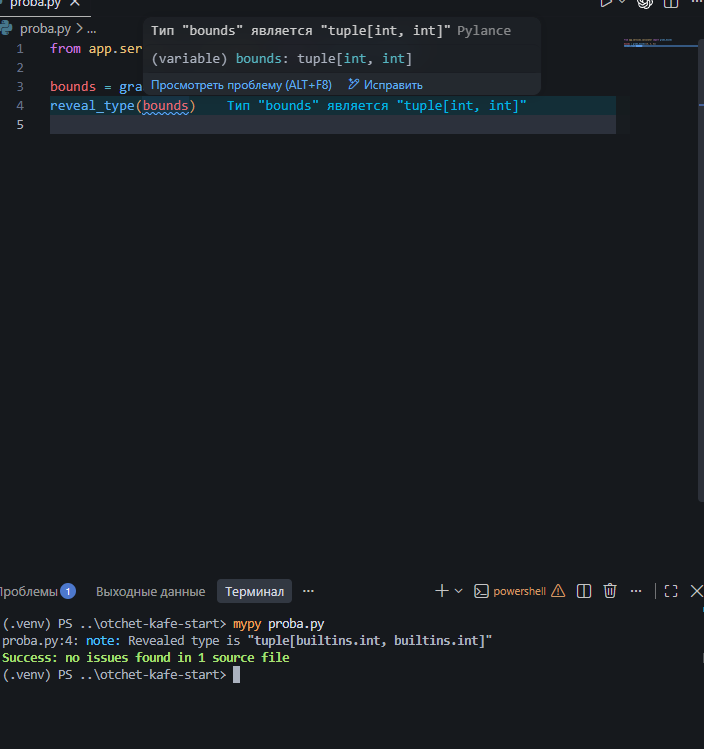

# Отчёт · Проверка типов: Pylance и mypy

Работа выполнена на втором архиве проекта «Отчёт кафе»
(`lesson_06/otchet-kafe-start`), глава 4.3.

## 1. Редактор до настройки

В корне проекта создан файл `proba.py` с двумя неверными вызовами:
`format_title(40)` и `format_kopeks("1250")`. Выбран интерпретатор
из окружения проекта, внизу справа окна написано `.venv (3.15.2)`.

В режиме `off` в файле подчёркнуто 0 аргументов. Ошибки типов в этом
режиме не показываются, аннотации идут только в подсказки.

## 2. Включение режима basic

Настройка `python.analysis.typeCheckingMode` выбрана на вкладке Workspace (Рабочая область),
поэтому VS Code записал её в файл `.vscode/settings.json` внутри проекта.

## 3. Ошибки в редакторе

После смены режима в `proba.py` подчёркнуты 40 и "1250". На вкладке
после имени файла стоит цифра 2.

Сообщение над `40`:

Pylance называет тип переданного значения `int`. Параметр `title`
функции `format_title` ожидает тип `str`. Правило, по которому
выдано сообщение, называется `arg-type`.

## 4. Моя ошибка и панель Problems

Мой вариант — передать кортеж вместо строки. В `proba.py` добавлен вызов `normalize_name`, он стоит
в строке 6. Функция объявлена в модуле `text`, её подпись:
`normalize_name(name: str) -> str`.

В панели Problems у `proba.py` 3 ошибки. Моя ошибка стоит
на месте `[Ln 6, Col 23]`, её короткая причина в конце сообщения:
`tuple[Literal[30], Literal[49]]` невозможно назначить `str`.

## 5. Четыре режима на одном файле

Файл `rezhimy.py` проверен во всех четырёх режимах.
Число сообщений в панели Problems:

| Режим | Сообщений |
|---|---|
| `off` | 1 |
| `basic` | 2 |
| `standard` | 3 |
| `strict` | 9 |

Только в `standard` и `strict` появилось сообщение про переменную
`label`: `Элемент "label", возможно, не привязан`. После опыта возвращён режим `basic`.

## 6. Ошибки в терминале

Версия mypy: `1.15.0`. Команда `mypy proba.py` закончилась строкой
`Found 3 errors in 1 file (checked 1 source file)`.

Строка с моей ошибкой: `proba.py:6: error: Argument 1 to "normalize_name" has incompatible type "tuple[int, int]"; expected "str"  [arg-type]`.
В сообщении mypy параметр назван `Argument 1`, а Pylance называл его `name`.

## 7. Исправление

Исправленные вызовы:

| Было | Стало |
|---|---|
| `format_title(40)` | `format_title(" Итог ")` |
| `format_kopeks("1250")` | `format_kopeks(1250)` |
| `normalize_name((30,49))` | `normalize_name("Иванов И.И.")` |

После сохранения файла проверка повторена.

`mypy proba.py`: `Success: no issues found in 1 source file`.
`mypy app`: `Success: no issues found in 15 source files`.

## 8. Проект без аннотаций

На первом архиве mypy вывел `Found 17 errors in 10 files`.
У всех ошибок код `[no-untyped-def]`. Ошибки появились потому, что в `pyproject.toml`
включён параметр `disallow_untyped_defs = true`.

Первая строка списка: `app\utils\text.py:1: error: Function is missing a type annotation  [no-untyped-def]`.

## 9. Какой тип видит проверка

Pylance при наведении на `bounds` показал `tuple[int, int]`. mypy в строке
`reveal_type` вывел `tuple[builtins.int, builtins.int]`.

## 10. Итог

Если Pylance ошибок не показывает, а mypy показывает, первым делом
проверяю, настроки окружения.
