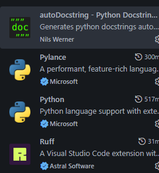
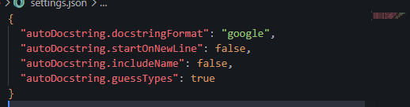
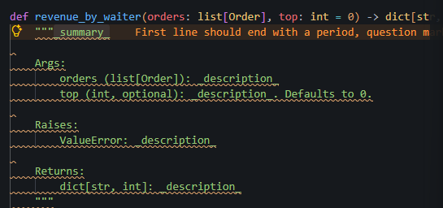
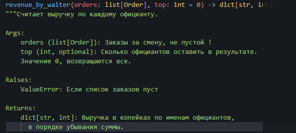
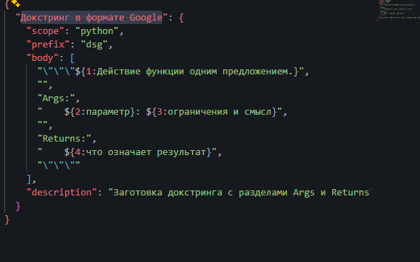
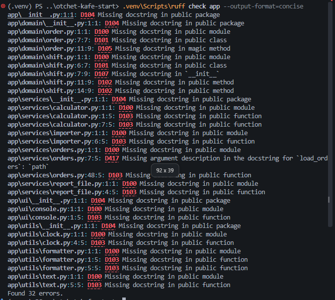
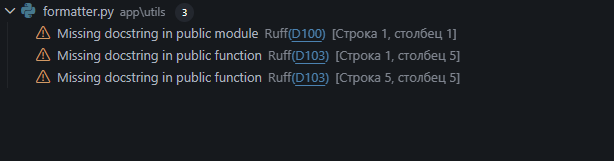
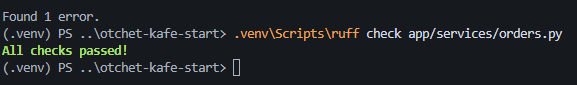
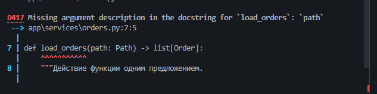
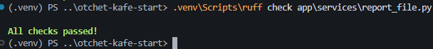

# Отчёт · Докстринги в VS Code: генератор и проверка

Работа выполнена на втором архиве проекта «Отчёт кафе»
(`lesson_07/otchet-kafe-start`), глава 4.10.

## 1. Расширения

Установлены расширения `njpwerner.autodocstring` и `charliermarsh.ruff`.
Автор autoDocstring на карточке расширения: Nils Werner. Издатель Ruff: Astral Software.



## 2. Настройки проекта

Настройки генератора записаны в файл `settings.json`. Он лежит внутри проекта
и попадает в репозиторий, поэтому заготовка у всех, кто откроет проект,
будет одинаковой.



Формат заготовки — `google`. С проверкой Ruff он согласуется, потому что
в `pyproject.toml` записано `convention = "google"`. Настройка
`startOnNewLine` оставлена `false`: иначе Ruff выдаст замечание `D212`.

## 3. Заготовка генератора

Генератор вызван у функции `revenue_by_waiter` способом: ctr+shift+2.



В заготовке разделы `Args:`, `Raises:` и `Returns:`. Раздел `Raises:` появился,
потому что в теле функции есть `raise ValueError`. Типов в скобках нет, потому что
выбран формат ___.

## 4. Заполненный докстринг



Краткая строка: «Считает выручку по каждому официанту». Параметр `top` описан так: «Сколько официантов оставить в результате. Значение 0, возвращаются все».

## 5. Сниппет

Сниппет записан в файл `python.code-snippets`. Его название — «Докстринг в формате Google», слово для вызова —
`dsg`. Им вставлен докстринг функции `load_orders`.



Имя параметра `path` в сниппет вписано вручную: сниппет вставляет одинаковый
текст для любой функции и подпись не читает.

## 6. Проверка всего пакета

Команда `ruff check app --output-format=concise` закончилась строкой
`Found 32 errors.`



Чаще других в выводе два кода. `D100` означает: отсутствует докстринг публичного модуля.
`D103` означает: отсутствует докстринг публичной функции.

## 7. Замечания в редакторе

Модуль моего варианта — `report_file.py`. В панели Problems у него 32 замечания.
Источник у каждого замечания — `Ruff`.



## 8. Модуль orders.py без замечаний

Докстринг модуля `orders.py`: «Модуль для работы с заказами».
Докстринг `sort_orders_in_place`: «Сортирует список заказов на месте по убыванию стоимости».



## 9. Опыт с D417



Правило D417 сравнивает раздел `Args:` с параметрами функции. Остальные правила
из вывода проверяют, есть ли докстринг и как он оформлен. После опыта
строка про `top` возвращена.

## 10. Модуль моего варианта

До работы проверка модуля `report_file.py` выводила `Found 32 errors.`, после —
`All checks passed!`. В пакете `app` осталось `Found 28 errors.`



Докстринг одной из функций модуля:

```python
def save_report(path: Path, lines: list[str]) -> int:
    """Сохранить строки отчёта в файл и вернуть их количество.

    Args:
        path: Путь к файлу отчёта.
        lines: Строки отчёта.

    Returns:
        Количество записанных строк.
    """
```

## 11. Итог

Ruff проверяет, что докстринг есть, оформлен по правилам и перечисляет
все параметры подписи. Верность описания по смыслу Ruff не проверяет:
докстринг с текстом `jjjjfhfhi.` для него в порядке.
